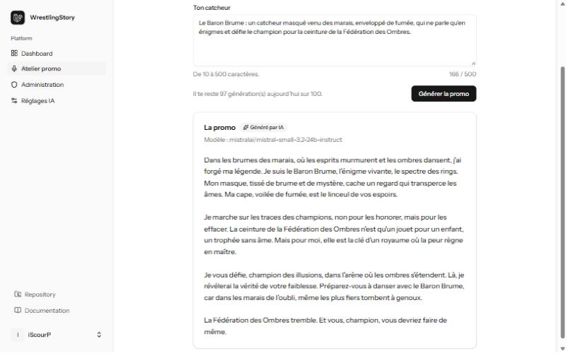
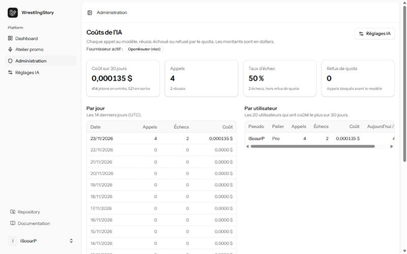
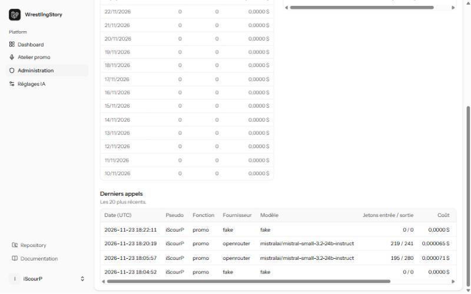
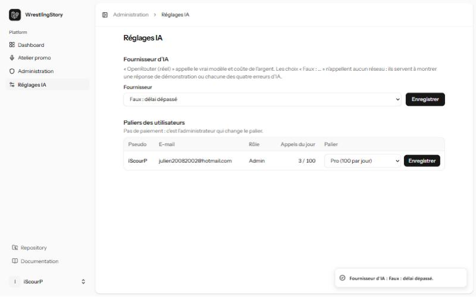
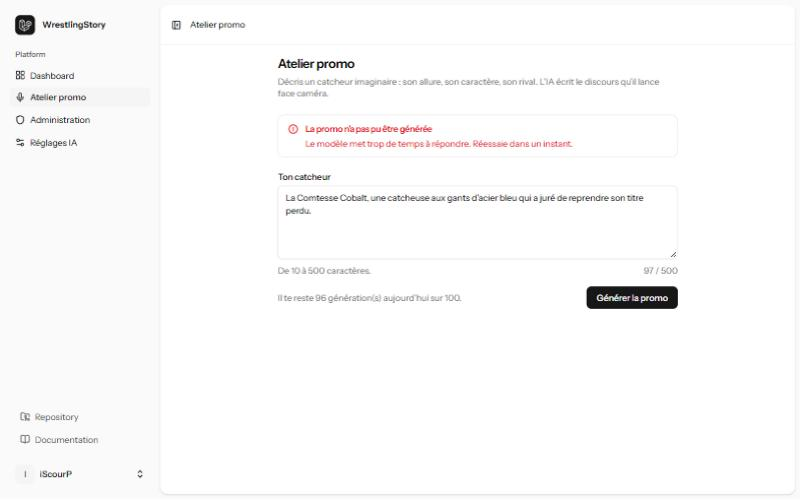

# WrestlingStory — Rapport d'avancement, revue n°1 (24 novembre 2026)

**Groupe** : Julien (JulienFra), Florentin (Florentin28)
**Production** : https://wrestlingstory.82-25-58-90.sslip.io
**Dépôt** : https://github.com/JulienFra/WrestlingStory

WrestlingStory est un jeu web pour les fans de catch. Le joueur dirige une fédération fictive et écrit son show en texte libre. Un modèle de langage raconte chaque segment et propose des effets. L'application borne ces effets, les applique, puis en tire la note du show, l'audience et les finances.

## 1. Fonctionnalités en production

### Socle technique

- **Stack** (décision D-001) :
  - Laravel 13 (PHP 8.4) et Vue 3 via Inertia ;
  - PostgreSQL 17 ;
  - le starter kit officiel, avec Fortify pour l'inscription, la connexion et les passkeys.
- **Hébergement** (décision D-002) :
  - le VPS HOSTKEY du projet 1, à côté de ChatPulse, qui n'a pas été modifié ;
  - Nginx et PHP 8.4-FPM, avec un PostgreSQL 17 séparé sous Docker ;
  - pas de nom de domaine : l'adresse gratuite `sslip.io` permet d'avoir un vrai certificat HTTPS (Let's Encrypt). Les passkeys exigent HTTPS ;
  - en-têtes de sécurité (HSTS, `X-Frame-Options`, etc.), `APP_DEBUG=false` et cookies `secure`.
- **CI/CD** :
  - chaque PR vers `main` passe 4 checks obligatoires et parallèles : `Lint` (Pint, oxlint), `Types` (Larastan niveau 7, vue-tsc), `Tests` (PHPUnit sur PostgreSQL 17) et `Build` (Vite) ;
  - après une CI verte sur `main`, le déploiement est automatique : le build se fait sur GitHub, l'envoi en SSH avec une clé dédiée, puis viennent les migrations et une bascule atomique entre versions ;
  - le workflow vérifie enfin que le site répond.
- **Comptes** :
  - le pseudo est unique (sans tenir compte des majuscules) et n'accepte que lettres, chiffres et `_` ;
  - l'e-mail doit avoir un format réel ;
  - tout est vérifié côté serveur, même si le formulaire est modifié avec les outils du navigateur ;
  - deux rôles, joueur et administrateur, et deux paliers, Gratuit et Pro.

### Fonction IA de démonstration : l'atelier promo

Le joueur décrit un catcheur imaginaire, et le modèle écrit la promo que ce catcheur lance face caméra.

- **L'appel** passe uniquement par le serveur. Le modèle reçoit seulement le texte du joueur : ni son e-mail, ni son pseudo.
- **Le modèle** (décision D-003) est `mistralai/mistral-small-3.2-24b-instruct`, via OpenRouter. Chaque requête demande des fournisseurs qui ne conservent pas les données et ne s'en servent pas pour entraîner (`zdr: true`, `data_collection: deny`).
- **La réponse** est traitée comme une entrée non fiable : une réponse vide ou trop longue est refusée.
- **Transparence** : chaque sortie porte le badge « Généré par IA » et le nom du modèle.

### Journal des appels, quotas et tableau de bord des coûts (O4)

- **Le journal** : chaque tentative, réussie, échouée ou refusée par le quota, ajoute une ligne à `ai_calls`. Elle contient la date, l'utilisateur, la fonction, le fournisseur, le modèle, les jetons d'entrée et de sortie, le coût réel renvoyé par OpenRouter, la durée et le résultat. Le texte du joueur et la réponse ne sont pas conservés.
- **Le quota** du jour dépend du palier (10 appels en Gratuit, 100 en Pro). Il est vérifié **avant** l'appel : au-delà, aucun appel n'est fait et un message s'affiche.
- **Le tableau de bord administrateur** est protégé côté serveur. Il affiche :
  - sur 30 jours : le coût, le nombre d'appels, le taux d'échec et les refus de quota ;
  - le détail par jour, puis par utilisateur, avec ses appels du jour comparés à son quota ;
  - les 20 derniers appels.

**Coûts observés en production** (premiers appels réels) :

| Appel | Jetons (entrée / sortie) | Coût |
| --- | --- | --- |
| 1 | 195 / 280 | 0,000071 $ |
| 2 | 219 / 241 | 0,000065 $ |

Une promo coûte donc environ **0,00007 $**. La clé OpenRouter est plafonnée à **0,50 €**, soit de l'ordre de 7 000 promos.

### Expérience d'erreur IA (O5)

Les 4 cas ont chacun un message clair en français. La saisie est conservée, aucune trace technique n'est affichée, et le reste du jeu reste utilisable.

| Cas | Message affiché |
| --- | --- |
| Délai dépassé | « Le modèle met trop de temps à répondre. Réessaie dans un instant. » |
| Fournisseur en panne | « Le service d'IA est indisponible pour le moment. Le reste du jeu fonctionne normalement. » |
| Crédit épuisé | « Le crédit d'IA du jeu est épuisé. Préviens un administrateur. » |
| Réponse inexploitable | « La réponse de l'IA était inutilisable. Réessaie ou reformule ta demande. » |

Pour la démo, la page **Réglages IA** permet de choisir le vrai modèle, ou un faux fournisseur qui provoque l'une de ces erreurs. La même page permet de changer le palier d'un utilisateur : il n'y a pas de paiement réel.

### Qualité

- **125 tests automatisés.** Aucun n'appelle le vrai modèle : on utilise un faux fournisseur et `Http::fake`, et `Http::preventStrayRequests()` bloque tout appel réseau imprévu.
- **Un audit de sécurité.** Aucune faille connue dans les dépendances. Un correctif a été appliqué : la base locale n'était pas limitée à `127.0.0.1`.
- **Une méthode de travail documentée dans le dépôt** :
  - `AGENTS.md` et les skills du groupe ;
  - les décisions D-001 à D-003 ;
  - les tickets et le journal de chaque jour.

## 2. Point fort

**La chaîne complète, de la PR à la production, est automatique et vérifiée.** Une PR ne peut être fusionnée que si ses 4 checks sont verts. La fusion déploie toute seule, et le déploiement vérifie que le site répond. Côté IA, chaque appel est journalisé avec son coût réel, et le quota est appliqué avant l'appel. Les 4 erreurs se montrent à volonté, sans dépenser de crédit.

## 3. Point faible

**Le cœur du jeu (O1) n'existe pas encore.** On n'a encore ni fédération, ni catcheurs, ni booking de segment. L'atelier promo prouve que la chaîne IA fonctionne, mais il ne modifie pas encore une entité métier. Les entités métier (O2) sont à écrire à deux, avec Florentin, qui n'a pas encore livré de PR.

**Un point de conception est à trancher** : aujourd'hui, un appel en échec compte dans le quota du joueur. Une panne du fournisseur consomme donc ses générations, alors que rien n'est payé.

## 4. Objectif pour la suite (d'ici la revue n°2, le 15 décembre)

1. **Le schéma de données**, à deux : fédérations, catcheurs, titres et règnes, shows, segments, matchs et rivalités, avec des données de démo entièrement fictives (O2).
2. **Le booking d'un segment** (O1). Le joueur écrit le segment, et le modèle renvoie une narration et des effets en JSON. Le code valide ces effets, les borne et les applique en base, puis calcule la note, l'audience et les finances sans rappeler le modèle.
3. **Les écrans du domaine et les comptes**, par Florentin : roster, titres, calendrier et rivalités. Il y ajoute la landing page avec le pricing fondé sur les coûts observés (O6) et la page légale (O7).
4. **Les finitions** : le quota en cas d'échec, la limitation des tentatives sur l'inscription, et la préparation du rapport final.
